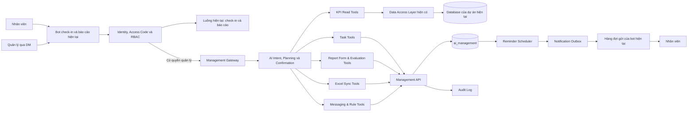
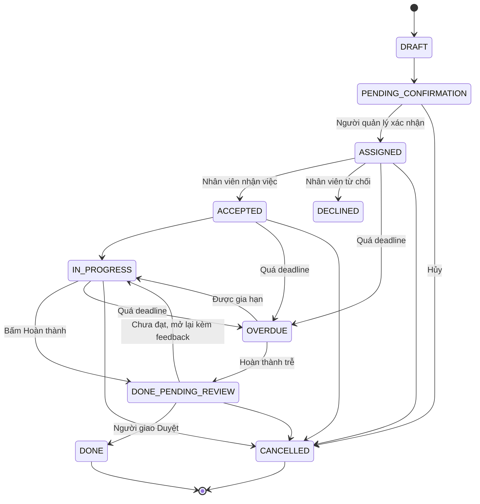
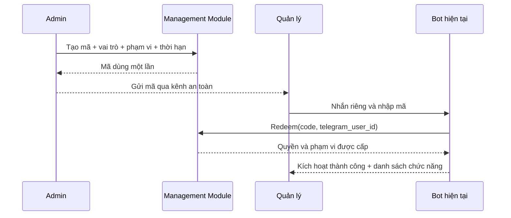
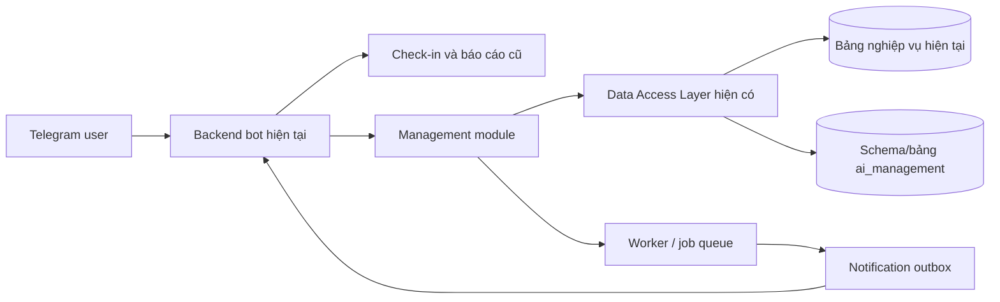

# Kế hoạch xây dựng trợ lý AI quản lý trên bot Telegram hiện tại

> Phiên bản: 2.3  
> Ngày cập nhật: 19/10/2026 (chốt quyết định mục 21)  
> Múi giờ vận hành: `Asia/Ho_Chi_Minh`  
> Phạm vi: mở rộng trực tiếp dự án bot check-in/báo cáo hiện tại theo module; không tạo bot mới; không kết nối database bằng IP riêng; không phụ thuộc Hermes

## 1. Mục tiêu

Xây dựng một trợ lý AI cho phép người quản lý nhắn bằng ngôn ngữ tự nhiên để:

- Tìm đúng nhân viên theo dữ liệu KPI hiện có.
- Giao một hoặc nhiều nhiệm vụ cho cá nhân hoặc nhóm.
- Đặt thời gian bắt đầu và deadline.
- Gia hạn deadline có lý do và lưu lịch sử.
- Gửi thông báo qua Telegram.
- Tự động nhắc trước hạn, khi đến hạn và khi quá hạn.
- Theo dõi trạng thái: đã giao, đã nhận, đang làm, hoàn thành, quá hạn, hủy.
- Tổng hợp tiến độ và đối chiếu với lịch làm việc/KPI.
- Bảo đảm AI không được sửa dữ liệu nhân viên, chấm công hoặc KPI gốc.
- Tạo và phát hành form báo cáo.
- Tổng hợp, phân tích và đánh giá báo cáo bằng AI agent.
- Nhập/xuất và đồng bộ dữ liệu Excel có kiểm soát.
- Gửi tin nhắn cá nhân theo chỉ định của quản lý.
- Tạo quy tắc nhắc lịch, cảnh báo công việc và escalation.
- Tự động trao đổi cơ bản với nhân viên theo playbook được duyệt.
- Trò chuyện với bot để tạo báo cáo tuần, bổ sung dữ liệu và đánh giá nhân viên.

### 1.1. Yêu cầu không được phá vỡ

- Giữ nguyên toàn bộ chức năng check-in, check-out, chấm công và báo cáo đang chạy.
- Không thay bot token và không yêu cầu nhân viên add/start một bot khác.
- Chức năng quản lý chỉ hoạt động trong tin nhắn riêng với bot.
- Người dùng phải kích hoạt bằng mã do quản trị viên cấp.
- Sau khi kích hoạt, quyền được gắn với Telegram numeric user ID; không dùng mã làm danh tính lâu dài.
- Mỗi người chỉ nhìn thấy dữ liệu và thao tác trong phạm vi được cấp.
- Những hành động có tác động tới người khác phải có bản xem trước và xác nhận.

### 1.2. Hai chế độ trên cùng một bot

| Chế độ | Đối tượng | Chức năng |
|---|---|---|
| Nhân viên | Người dùng hiện tại | Check-in, check-out, gửi báo cáo, xem thông tin cá nhân và các chức năng đang có |
| Quản lý | Người đã kích hoạt mã trong DM | Giao việc, form báo cáo, tổng hợp/đánh giá, Excel, gửi tin, rules, cảnh báo và AI agent |

Bot chọn chế độ bằng danh tính và quyền đã lưu, không yêu cầu người dùng phải
nhớ tên skill hoặc câu lệnh kỹ thuật.

## 2. Nguyên tắc kiến trúc

1. Tái sử dụng connection pool và Data Access Layer của dự án bot hiện tại;
   không tạo kết nối PostgreSQL từ xa bằng IP riêng cho module AI.
2. AI không được truy cập database trực tiếp hoặc chạy SQL tùy ý.
3. Dữ liệu quản lý nằm trong schema/bộ bảng riêng, đề xuất tên `ai_management`,
   nhưng dùng cấu hình database sẵn có của dự án cũ.
4. Mọi thao tác đọc/ghi của AI phải qua repository/service có danh sách hàm cho phép.
5. Thao tác giao việc, gia hạn, hủy việc phải có xác nhận của người có quyền.
6. Mọi thay đổi phải có nhật ký kiểm toán, người thực hiện và thời gian.
7. Gửi Telegram và ghi database phải chống gửi trùng.
8. Thời gian lưu trong database bằng UTC; hiển thị theo `Asia/Ho_Chi_Minh`.

## 3. Kiến trúc tổng thể đề xuất



### 3.1. Các thành phần

| Thành phần | Trách nhiệm |
|---|---|
| Bot/Gateway hiện tại | Tiếp tục nhận check-in, báo cáo và định tuyến thêm yêu cầu quản lý |
| Access Code & RBAC | Kích hoạt quản lý, xác thực Telegram ID và giới hạn quyền/phạm vi |
| AI Intent & Planning | Hiểu yêu cầu, chọn đúng công cụ, hỏi lại khi thiếu thông tin |
| KPI Read Tools | Tìm nhân viên, nhóm, lịch làm việc, chấm công và KPI |
| Management API | Nhiệm vụ, form, báo cáo, Excel, tin nhắn, rules và cảnh báo |
| `ai_management` | Lưu nhiệm vụ, form, đánh giá, rules và toàn bộ lịch sử thay đổi |
| Reminder Scheduler | Tìm các mốc cần nhắc và tạo thông báo |
| Notification Outbox | Bảo đảm thông báo được gửi đúng một lần hoặc retry an toàn |
| Telegram bot hiện tại | Tái sử dụng bot đang check-in/báo cáo để gửi nhiệm vụ và nhận phản hồi |
| Audit Log | Truy vết ai đã làm gì, khi nào và vì sao |

### 3.2. Quyết định bắt buộc: tái sử dụng bot hiện tại

**Không tạo và không add thêm Telegram bot mới.** Bot đang quản lý check-in và
báo cáo tiếp tục là đầu mối Telegram duy nhất. Hệ thống mới chỉ bổ sung năng
lực phía sau bot:

- Thêm intent `giao việc`, `gia hạn`, `xem tiến độ`, `hoàn thành` vào bộ định tuyến hiện tại.
- Thêm Management Tools để bot gọi Management API.
- Thêm các callback có namespace riêng như `task:accept:<id>`,
  `task:complete:<id>`, `task:extend:<id>` để không xung đột với check-in.
- Tái sử dụng Telegram user ID/chat ID và mapping nhân viên mà bot hiện tại đã có.
- Tái sử dụng cơ chế xác thực người dùng và danh sách quản lý hiện tại khi phù hợp.
- Mọi thông báo nhiệm vụ vẫn do chính bot hiện tại gửi.

Một Telegram bot token chỉ nên có **một đầu mối nhận update**. Không được chạy
thêm một tiến trình polling hoặc webhook độc lập bằng cùng token, vì hai tiến
trình có thể tranh nhau nhận tin hoặc Telegram sẽ từ chối cấu hình.

Phương án đã chốt là tích hợp module: thêm router/handler quản lý vào backend
bot hiện tại. Scheduler hoặc AI worker có thể chạy nền, nhưng chỉ trao đổi qua
job queue/service nội bộ; chúng không giữ `TELEGRAM_BOT_TOKEN` và không giao
tiếp trực tiếp với Telegram.

Không đưa logic nhiệm vụ vào phần check-in theo kiểu sửa chắp vá. Hai module
được tách về code và dữ liệu, nhưng dùng chung gateway Telegram và danh tính
người dùng.

## 4. Phân tách quyền truy cập

### 4.1. Dữ liệu KPI và dữ liệu cũ

Module quản lý dùng lại Data Access Layer/repository của dự án bot hiện tại,
không khai báo host, IP, port hoặc mật khẩu database lần thứ hai.

AI chỉ được gọi các hàm đọc đã đăng ký, ví dụ:

- `find_employee`
- `list_teams`
- `get_work_schedule`
- `get_attendance_summary`
- `get_kpi_summary`

Không cung cấp cho AI công cụ SQL tổng quát. Các thao tác ghi nghiệp vụ cũ như
check-in hoặc báo cáo vẫn do module hiện tại thực hiện; module AI không được gọi
trực tiếp `INSERT`, `UPDATE`, `DELETE`, `TRUNCATE`, `CREATE`, `ALTER` hoặc `DROP`
trên các bảng cũ.

### 4.2. Schema/bộ bảng nhiệm vụ

Tạo schema hoặc nhóm bảng riêng trong database mà dự án hiện tại đang dùng:

```text
Schema/table namespace: ai_management
Application role: management_service
Migration role: management_migrator
Reporting role: management_reader
```

Phân quyền:

| Role | Quyền |
|---|---|
| `management_service` | Đọc/ghi các bảng quản lý qua API; không sửa schema |
| `management_migrator` | Tạo và cập nhật schema; chỉ dùng khi triển khai |
| `management_reader` | Chỉ đọc báo cáo quản lý |
| Module dữ liệu cũ | Giữ nguyên quyền và hành vi hiện tại; không nhận lệnh SQL từ AI |

Nếu PostgreSQL và cách triển khai hiện tại hỗ trợ nhiều role, nên dùng role
`management_service` riêng. Nếu ứng dụng đang dùng một role chung, phải cưỡng
chế ranh giới bằng repository allowlist, review migration và integration test.

## 5. Mô hình dữ liệu nhiệm vụ trong `ai_management`

### 5.1. Bảng `tasks`

| Cột | Kiểu đề xuất | Ý nghĩa |
|---|---|---|
| `id` | UUID | ID nhiệm vụ |
| `title` | text | Tiêu đề ngắn |
| `description` | text | Nội dung chi tiết |
| `status` | enum/text | Trạng thái hiện tại |
| `priority` | enum/text | LOW, NORMAL, HIGH, URGENT |
| `starts_at` | timestamptz | Thời gian bắt đầu |
| `due_at` | timestamptz | Deadline hiện tại |
| `completed_at` | timestamptz nullable | Thời gian hoàn thành |
| `created_by` | text/UUID | Người giao việc |
| `source_platform` | text | telegram, web, api... |
| `source_message_id` | text nullable | Tin nhắn nguồn |
| `idempotency_key` | text unique | Chống tạo trùng |
| `display_code` | text unique | Mã hiển thị ngắn dạng `#T-104` để nhận diện và tích đúng task |
| `reminder_mode` | enum/text | DAILY_AFTER_CHECKIN hoặc ONCE_BEFORE_DUE |
| `created_at` | timestamptz | Thời gian tạo |
| `updated_at` | timestamptz | Thời gian cập nhật |
| `version` | integer | Khóa optimistic locking |

### 5.2. Bảng `task_assignees`

| Cột | Ý nghĩa |
|---|---|
| `task_id` | Liên kết nhiệm vụ |
| `employee_id` | ID nhân viên từ `telegram_kpi.public.employees` |
| `employee_code_snapshot` | Mã nhân viên tại thời điểm giao |
| `employee_name_snapshot` | Tên tại thời điểm giao |
| `telegram_user_id_snapshot` | Telegram ID tại thời điểm giao |
| `assignment_status` | ASSIGNED, ACCEPTED, DECLINED, DONE_PENDING_REVIEW, DONE |
| `assigned_at` | Thời gian giao |
| `accepted_at` | Thời gian nhận việc |
| `completed_at` | Thời gian nhân viên bấm hoàn thành |
| `reviewed_at` | Thời gian người giao duyệt/chưa đạt |
| `reviewed_by` | Người duyệt |
| `review_note` | Feedback bắt buộc khi chưa đạt |

Lưu snapshot để báo cáo cũ không bị sai khi nhân viên đổi tên, phòng ban hoặc Telegram ID.

### 5.3. Bảng `task_events`

Là nhật ký bất biến, chỉ thêm mới:

| Cột | Ý nghĩa |
|---|---|
| `id` | ID sự kiện |
| `task_id` | Nhiệm vụ liên quan |
| `event_type` | CREATED, ASSIGNED, ACCEPTED, COMMENT, COMPLETED, REVIEW_APPROVED, REVIEW_REJECTED, REOPENED, EXTENDED, CANCELLED, REMINDED... |
| `actor_type` | USER, EMPLOYEE, AI, SYSTEM |
| `actor_id` | Người/hệ thống thực hiện |
| `old_values` | JSON dữ liệu trước thay đổi |
| `new_values` | JSON dữ liệu sau thay đổi |
| `reason` | Lý do, bắt buộc khi gia hạn/hủy |
| `created_at` | Thời gian sự kiện |

Không cho phép sửa hoặc xóa `task_events` bằng tài khoản ứng dụng.

### 5.4. Bảng `reminders`

| Cột | Ý nghĩa |
|---|---|
| `id` | ID lịch nhắc |
| `task_id` | Nhiệm vụ |
| `assignee_id` | Người nhận |
| `remind_at` | Thời điểm cần nhắc |
| `reminder_type` | BEFORE_DUE, DUE_NOW, OVERDUE, NOT_ACCEPTED, DAILY_AFTER_CHECKIN, CUSTOM |
| `status` | PENDING, CLAIMED, SENT, FAILED, CANCELLED |
| `attempt_count` | Số lần thử |
| `next_attempt_at` | Thời gian retry |
| `sent_at` | Thời gian gửi thành công |

### 5.5. Bảng `notification_outbox`

Dùng mô hình transactional outbox để việc ghi nhiệm vụ và yêu cầu gửi thông báo nằm trong cùng transaction.

| Cột | Ý nghĩa |
|---|---|
| `id` | ID thông báo |
| `deduplication_key` | Khóa chống gửi trùng |
| `channel` | telegram, email... |
| `recipient` | Telegram ID hoặc địa chỉ nhận |
| `payload` | Nội dung JSON |
| `status` | PENDING, SENDING, SENT, FAILED |
| `attempt_count` | Số lần thử |
| `available_at` | Thời điểm được phép gửi |

## 6. Vòng đời nhiệm vụ



Quy tắc:

- AI luôn tạo `DRAFT` trước.
- Chỉ chuyển sang `ASSIGNED` sau khi người có quyền xác nhận.
- Bấm `Nhận việc` là bắt buộc; chưa bấm sau 15 phút (cấu hình 15–30 phút) thì
  nhắc lại, trạng thái vẫn `ASSIGNED` để tổng hợp cuối ngày phân biệt được
  "chưa nhận việc" với "đã nhận chưa làm".
- Nhân viên bấm `Hoàn thành` → `DONE_PENDING_REVIEW`; người giao bấm `Duyệt`
  → `DONE` hoặc `Chưa đạt` → mở lại task.
- `Chưa đạt` bắt buộc kèm feedback; hệ thống tạo sự kiện `REVIEW_REJECTED`,
  bot gửi feedback cho nhân viên và mở lại task; nếu deadline đã quá thì task
  quay lại `OVERDUE`, người giao có thể kèm deadline mới khi trả lại.
- Gia hạn phải tạo sự kiện `EXTENDED`, giữ cả deadline cũ và mới.
- Phản hồi của nhân viên/người giao lưu sự kiện `COMMENT` và được forward qua
  DM cho bên kia.
- Không sửa đè lịch sử.
- Hoàn thành sau deadline vẫn lưu là `DONE`, nhưng báo cáo phải đánh dấu hoàn thành trễ.

## 7. Management API — phân hệ nhiệm vụ

API chỉ mở trong mạng nội bộ hoặc sau API Gateway có xác thực.

### 7.1. API đọc

| Method | Endpoint | Chức năng |
|---|---|---|
| `GET` | `/health` | Kiểm tra dịch vụ và database |
| `GET` | `/tasks/{id}` | Xem một nhiệm vụ |
| `GET` | `/tasks` | Lọc nhiệm vụ theo người, nhóm, trạng thái, thời gian |
| `GET` | `/employees/search?q=` | Tìm nhân viên qua KPI read connector |
| `GET` | `/groups/{id}/members` | Xem nhân viên trong nhóm |
| `GET` | `/reports/overdue` | Danh sách quá hạn |
| `GET` | `/reports/workload` | Khối lượng việc theo nhân viên |

### 7.2. API ghi

| Method | Endpoint | Chức năng |
|---|---|---|
| `POST` | `/task-drafts` | Tạo bản nháp |
| `POST` | `/task-drafts/{id}/confirm` | Xác nhận và giao việc |
| `POST` | `/tasks/{id}/accept` | Nhân viên nhận việc |
| `POST` | `/tasks/{id}/start` | Bắt đầu làm |
| `POST` | `/tasks/{id}/complete` | Hoàn thành |
| `POST` | `/tasks/{id}/extend` | Gia hạn deadline |
| `POST` | `/tasks/{id}/cancel` | Hủy nhiệm vụ |
| `POST` | `/tasks/{id}/reminders` | Tạo mốc nhắc riêng |
| `POST` | `/tasks/{id}/comments` | Nhân viên phản hồi hoặc người giao trả lời về task |
| `POST` | `/tasks/{id}/review` | Duyệt (APPROVE) hoặc chưa đạt (REJECT, bắt buộc feedback, có thể kèm deadline mới) |

Mỗi request ghi cần có:

```http
Authorization: Bearer <service-token>
Idempotency-Key: <unique-key>
X-Actor-Id: <authorized-user-id>
X-Source-Platform: telegram
```

### 7.3. Ví dụ tạo bản nháp

```json
{
  "title": "Gọi lại khách hàng chưa chốt",
  "description": "Liên hệ danh sách khách hàng nóng và cập nhật kết quả",
  "assignee_employee_ids": ["employee-uuid"],
  "priority": "HIGH",
  "starts_at": "2026-10-19T08:00:00+07:00",
  "due_at": "2026-10-19T17:30:00+07:00",
  "reminder_policy": {
    "before_due_minutes": [120, 30],
    "notify_when_overdue": true
  }
}
```

### 7.4. Ví dụ gia hạn

```json
{
  "new_due_at": "2026-10-20T12:00:00+07:00",
  "reason": "Khách hàng yêu cầu gọi lại vào sáng mai",
  "expected_version": 3
}
```

`expected_version` giúp ngăn hai người cùng sửa deadline và ghi đè lẫn nhau.

## 8. Công cụ dành cho AI

AI chỉ nhìn thấy các tool nghiệp vụ, không nhìn thấy mật khẩu hoặc SQL ghi:

| Tool | Loại | Mục đích |
|---|---|---|
| `search_employees` | Đọc | Tìm nhân viên theo tên, mã, phòng ban |
| `get_group_members` | Đọc | Lấy nhân viên trong nhóm |
| `get_employee_schedule` | Đọc | Kiểm tra lịch trước khi đặt deadline |
| `get_employee_workload` | Đọc | Kiểm tra số nhiệm vụ đang mở |
| `create_task_draft` | Ghi giới hạn | Tạo bản nháp, chưa gửi |
| `confirm_task_assignment` | Ghi giới hạn | Giao việc sau xác nhận |
| `extend_task_deadline` | Ghi giới hạn | Gia hạn có lý do |
| `complete_task` | Ghi giới hạn | Đánh dấu hoàn thành |
| `review_completed_task` | Ghi giới hạn | Duyệt hoặc trả lại kèm feedback bắt buộc |
| `add_task_comment` | Ghi giới hạn | Gửi phản hồi về một task cụ thể |
| `cancel_task` | Ghi giới hạn | Hủy có lý do |
| `list_overdue_tasks` | Đọc | Xem nhiệm vụ quá hạn |

### 8.1. Quy tắc AI bắt buộc

- Không tự đoán nhân viên nếu có nhiều kết quả trùng tên.
- Kiểm tra nhân viên đang hoạt động trước khi giao.
- Kiểm tra nhân viên có Telegram ID trước khi hứa sẽ gửi thông báo.
- Hiển thị bản tóm tắt trước khi xác nhận: người nhận, nội dung, bắt đầu, deadline, mốc nhắc.
- Không xác nhận thay người quản lý.
- Không gia hạn khi thiếu lý do.
- Chưa đạt phải kèm feedback do người giao cung cấp; AI không tự viết feedback thay.
- Không dùng deadline đã qua.
- Không giao việc ngoài lịch làm việc nếu chưa cảnh báo người quản lý.
- Không sửa dữ liệu KPI/chấm công để “khớp” với nhiệm vụ.

## 9. Luồng hội thoại mẫu

### 9.1. Giao việc đầy đủ thông tin

Người quản lý:

> Giao cho Nguyễn Văn A gọi lại 20 khách nóng, hoàn thành trước 5 giờ chiều nay, nhắc trước 2 tiếng.

Hệ thống:

1. Tìm Nguyễn Văn A trong database KPI.
2. Nếu chỉ có một kết quả, kiểm tra trạng thái và lịch làm việc.
3. Tạo draft.
4. Trả về:

```text
Xác nhận giao việc:
- Người nhận: Nguyễn Văn A — NV001
- Nội dung: Gọi lại 20 khách nóng
- Deadline: 17:00 ngày 19/10/2026
- Nhắc việc: 15:00

Bạn có đồng ý giao việc không?
```

5. Chỉ khi người quản lý xác nhận mới gọi API confirm và gửi Telegram.

### 9.2. Thiếu thông tin

Người quản lý:

> Giao cho Hùng làm báo cáo.

AI phải hỏi ngắn gọn:

```text
Có 3 nhân viên tên Hùng. Bạn muốn giao cho ai, báo cáo gì và deadline khi nào?
```

### 9.3. Gia hạn

Người quản lý:

> Gia hạn việc báo cáo của Nguyễn Văn A tới 10 giờ sáng mai vì còn thiếu dữ liệu.

Hệ thống:

1. Tìm các nhiệm vụ đang mở phù hợp.
2. Nếu có nhiều nhiệm vụ, yêu cầu chọn.
3. Hiển thị deadline cũ, deadline mới và lý do.
4. Yêu cầu xác nhận.
5. Ghi sự kiện `EXTENDED`, cập nhật reminder và thông báo nhân viên.

## 10. Cơ chế nhắc việc

### 10.1. Hai chế độ nhắc, người giao chọn khi giao

| Chế độ | Cách nhắc |
|---|---|
| Hàng ngày | Gửi 15 phút sau khi nhân viên check-in của ngày đó, kèm danh sách task còn mở; không check-in thì không nhắc ngày đó; lặp mỗi ngày đến khi task xong hoặc hết hạn |
| Một lần trong ngày | Nhắc trước deadline trong ngày: task dưới 8 giờ nhắc trước 2 giờ và 30 phút; xong là hết |

Mốc "sau check-in" lấy từ sự kiện check-in của module chấm công hiện tại, chỉ
đọc sự kiện để lên lịch nhắc, không sửa dữ liệu chấm công.

### 10.2. Nhắc nhận việc

- Sau 15 phút (cấu hình 15–30 phút) giao mà chưa bấm `Nhận việc`: nhắc lại
  nhân viên kèm nút nhận.
- Vẫn chưa nhận: task vào tổng hợp cuối ngày với trạng thái "chưa nhận việc".

### 10.3. Nhắc quá hạn

- Quá hạn: nhắc nhân viên đúng danh sách task còn thiếu, kèm nút hoàn thành.
- Quá hạn 30 phút: nhắc nhân viên lần một.
- Quá hạn 2 giờ: thông báo người giao việc.
- Sau đó không spam; tối đa một lần theo chu kỳ cấu hình.

### 10.4. Tổng hợp cuối ngày

- Mặc định 18:00 (cấu hình được), gửi DM cho từng người giao việc.
- Nội dung: từng nhân viên — đã xong, đang chờ duyệt, chưa xong (kèm mã task
  cụ thể), chưa nhận việc.
- Chỉ gửi cho người có task còn mở hoặc phát sinh trong ngày.

### 10.5. Yêu cầu kỹ thuật

- Scheduler chạy mỗi phút hoặc dùng hàng đợi có delayed jobs.
- Claim reminder bằng transaction/row lock.
- Một reminder chỉ có một worker được xử lý.
- Retry theo exponential backoff.
- Telegram trả lỗi vĩnh viễn thì đánh dấu `FAILED` và báo quản trị.
- Deadline thay đổi phải hủy reminder cũ và tạo reminder mới trong cùng transaction.
- Reminder "hàng ngày sau check-in" được sinh khi nhận sự kiện check-in;
  unique key theo task + ngày + loại để restart không sinh trùng hoặc mất reminder.

## 11. Tích hợp Telegram

Phần này mở rộng bot check-in/báo cáo hiện tại, không triển khai bot mới.

### 11.1. Phân luồng chức năng trên cùng bot

Bot hiện tại cần phân loại tin nhắn theo intent:

| Intent | Module xử lý |
|---|---|
| Check-in, check-out, chấm công | Module chấm công hiện tại |
| Gửi báo cáo, xem báo cáo | Module báo cáo hiện tại |
| Giao việc, đặt deadline | Module nhiệm vụ mới |
| Nhắc việc, xem tiến độ, quá hạn | Module nhiệm vụ mới |
| Xin gia hạn, hoàn thành | Module nhiệm vụ mới |

Nếu một câu chứa cả báo cáo và giao việc, AI phải tách thành các hành động rõ
ràng và hiển thị bản xác nhận trước khi tạo nhiệm vụ.

### 11.2. Tin giao việc

Mỗi nhiệm vụ là một tin nhắn riêng (giao nhiều task một lần thì nhân viên nhận
nhiều tin, tích xong từng tin). Tin nhắn nên có:

- Mã hiển thị ngắn, ví dụ `#T-104`.
- Người giao.
- Nội dung.
- Mức ưu tiên.
- Deadline theo giờ Việt Nam.
- Nút `Nhận việc`, `Phản hồi`, `Hoàn thành`, `Xin gia hạn`.

### 11.3. Xin gia hạn

Nhân viên gửi thời gian đề xuất và lý do. Hệ thống tạo yêu cầu chờ người quản lý duyệt; không tự gia hạn trừ khi có chính sách cho phép.

### 11.4. Điều kiện gửi được tin

- Bot đã từng nhìn thấy chat hoặc nhân viên đã nhắn bot.
- Có Telegram user/chat ID hợp lệ.
- Bot chưa bị chặn.
- Người gửi lệnh có quyền giao việc cho nhân viên đó.

### 11.5. Tái sử dụng dữ liệu và nút hiện có

- Không yêu cầu nhân viên start bot lại nếu bot hiện tại đã biết chat ID.
- Không tạo bảng mapping Telegram thứ hai nếu bảng hiện tại đã đủ dữ liệu.
- Nếu mapping hiện tại thiếu hoặc trùng, xây một adapter đọc dữ liệu cũ thay vì
  sao chép thủ công.
- Callback của module nhiệm vụ phải có prefix `task:`; callback check-in giữ
  prefix hiện có.
- Menu bot có thể bổ sung mục `Công việc của tôi`, nhưng câu hỏi tự nhiên vẫn
  là giao diện chính.

### 11.6. Phản hồi trong quá trình làm

- Nhân viên bấm `Phản hồi` trên tin task bất kỳ lúc nào; khi bấm `Hoàn thành`
  có thể nhắn phản hồi kèm hoặc bỏ qua.
- Bot gửi thẳng DM người giao kèm mã task, tên nhân viên và nội dung phản hồi;
  đồng thời lưu sự kiện `COMMENT` vào `task_events`.
- Người giao trả lời lại qua bot thì tin đến nhân viên và cũng được lưu, tạo
  thành chuỗi hội thoại gắn với task.
- Phản hồi chỉ để trao đổi, không tự thay đổi trạng thái task. Người giao đọc
  phản hồi để quyết định giữ, gia hạn hoặc hủy; hủy phải có lý do và nhân viên
  được báo.

### 11.7. Duyệt hoặc chưa đạt

- Nhân viên bấm `Hoàn thành` → task chuyển `DONE_PENDING_REVIEW`.
- Người giao nhận tin duyệt kèm hai nút `Duyệt` và `Chưa đạt`.
- `Duyệt` → task `DONE`, ghi `completed_at` và `reviewed_by`, nhân viên nhận
  tin xác nhận.
- `Chưa đạt` bắt buộc nhắn feedback; bot gửi feedback đó cho nhân viên, task
  mở lại cho làm tiếp (sự kiện `REVIEW_REJECTED` + `REOPENED`). Nếu deadline
  đã quá, task quay lại `OVERDUE`; người giao có thể kèm deadline mới khi trả lại.
- Chỉ assignee mới bấm được nút trên task của mình; chỉ người giao và người có
  quyền quản lý task đó mới thấy nút duyệt.

## 12. Phân quyền người dùng

| Vai trò | Quyền đề xuất |
|---|---|
| Owner/Admin | Giao, sửa, gia hạn, hủy mọi nhiệm vụ |
| Manager | Giao và quản lý nhân viên thuộc phạm vi phụ trách |
| Team Lead | Giao trong nhóm được cấp quyền |
| Employee | Xem/nhận/cập nhật nhiệm vụ của chính mình, xin gia hạn |
| Auditor | Chỉ đọc nhiệm vụ và audit log |

Không dựa duy nhất vào username Telegram. Dùng Telegram numeric user ID và ánh xạ với tài khoản nội bộ.

## 13. Bảo mật

- Mật khẩu database đặt trong secret store hoặc `.env` không commit Git.
- Tạo mật khẩu riêng cho từng môi trường dev/staging/production.
- Dùng lại secret và connection manager hiện có; không sao chép chuỗi kết nối
  database vào prompt, log hoặc cấu hình riêng của AI.
- Không mở thêm cổng `5432` chỉ để phục vụ module quản lý.
- API chỉ nhận HTTPS hoặc chạy hoàn toàn trong mạng riêng.
- Token dịch vụ phải có thời hạn hoặc xoay định kỳ.
- Mã hóa backup.
- Log phải che mật khẩu, token và dữ liệu nhạy cảm.
- Giới hạn số request và kích thước nội dung nhiệm vụ.
- Validate dữ liệu ở API, không tin dữ liệu AI gửi lên.
- Dùng parameterized queries; không nối chuỗi SQL.
- Kiểm tra quyền trên từng nhiệm vụ, không chỉ kiểm tra đã đăng nhập.

## 14. Giám sát và vận hành

### 14.1. Chỉ số cần theo dõi

- Số task tạo mới mỗi ngày.
- Số task giao thành công/thất bại.
- Độ trễ từ xác nhận đến khi nhân viên nhận tin.
- Số notification retry và failed.
- Số task quá hạn.
- Số lần AI phải hỏi lại vì không xác định được nhân viên.
- Số thao tác ghi bị từ chối do thiếu quyền.
- Tình trạng Data Access Layer hiện tại và schema/bảng `ai_management`.

### 14.2. Cảnh báo

- Data Access Layer của dự án cũ lỗi liên tục.
- Không đọc/ghi được schema/bảng `ai_management`.
- Telegram Bot API lỗi liên tục.
- Outbox tồn đọng vượt ngưỡng.
- Scheduler không heartbeat.
- Có thao tác ghi bất thường hoặc nhiều lỗi quyền.

### 14.3. Backup

- Backup `ai_management` hằng ngày.
- Giữ tối thiểu 7 bản gần nhất và bản tuần/tháng theo nhu cầu.
- Kiểm thử phục hồi định kỳ.
- Audit log có thời hạn lưu tối thiểu 12 tháng hoặc theo chính sách công ty.

## 15. Lộ trình triển khai

### Giai đoạn 0 — Chốt yêu cầu và dữ liệu (0,5–1 ngày)

- Chốt ai có quyền giao việc.
- Chốt trạng thái nhiệm vụ.
- Chốt chính sách nhắc và gia hạn.
- Xác định bảng/ID nhân viên, nhóm và Telegram mapping trong KPI.
- Chốt môi trường chạy: máy nội bộ, server hoặc Docker.

Đầu ra: tài liệu yêu cầu và mapping dữ liệu được duyệt.

### Giai đoạn 1 — Database và quyền (1 ngày)

- Tạo `ai_management`.
- Tạo roles và grants.
- Tạo migration đầu tiên.
- Tạo tables, indexes, constraints và audit triggers cần thiết.
- Kiểm tra AI tools không thể gọi thao tác ghi lên bảng nghiệp vụ cũ.

Đầu ra: schema có thể chạy migration và rollback.

### Giai đoạn 2 — Management API, phân hệ nhiệm vụ (2–3 ngày)

- Health check.
- Tìm nhân viên/nhóm từ KPI connector.
- Tạo draft và confirm.
- Xem, lọc và cập nhật trạng thái.
- Gia hạn, hủy, hoàn thành.
- Idempotency và optimistic locking.
- Audit log.

Đầu ra: API có test tự động và tài liệu OpenAPI.

### Giai đoạn 3 — Telegram và scheduler (2–3 ngày)

- Tích hợp handler nhiệm vụ vào bot check-in/báo cáo hiện tại.
- Tái sử dụng mapping Telegram và cơ chế xác thực hiện tại.
- Gửi tin giao việc bằng chính bot hiện tại.
- Nút nhận việc/hoàn thành/xin gia hạn.
- Reminder scheduler.
- Outbox worker và retry.
- Thông báo lỗi cho quản trị.
- Kiểm thử không ảnh hưởng luồng check-in và báo cáo cũ.

Đầu ra: giao việc và nhắc việc đầu-cuối qua Telegram.

### Giai đoạn 4 — AI tools và hội thoại (2–4 ngày)

- Định nghĩa tool schemas.
- Xử lý tên trùng và thông tin thiếu.
- Bản xem trước trước khi xác nhận.
- Hỗ trợ giao nhiều người/nhóm.
- Hỗ trợ truy vấn tiến độ và quá hạn.
- Test các câu tiếng Việt thực tế.

Đầu ra: người quản lý chỉ cần nhắn tự nhiên.

### Giai đoạn 5 — Báo cáo và vận hành (1–2 ngày)

- Dashboard hoặc báo cáo cơ bản.
- Logging, metrics, alert.
- Backup và kiểm thử restore.
- Phân quyền production.
- Tài liệu vận hành và xử lý sự cố.

Đầu ra: hệ thống sẵn sàng chạy thử có kiểm soát.

### Tổng thời gian dự kiến

- MVP giao việc và quản lý truy cập: khoảng 8–12 ngày làm việc.
- Bổ sung form báo cáo, AI đánh giá, Excel, rules và hội thoại tự động: thêm 8–15 ngày.
- Bản đầy đủ có kiểm thử hồi quy, phân quyền chi tiết và giám sát: khoảng 16–27 ngày.

Thời gian thực tế phụ thuộc mã nguồn bot hiện tại, chất lượng mapping
nhân viên–Telegram, cấu trúc báo cáo và mức độ phức tạp của file Excel.

## 16. Kế hoạch kiểm thử

### 16.1. Kiểm thử quyền

- KPI repository đọc được đúng các bảng/view cần thiết.
- AI tool không thể `INSERT`, `UPDATE`, `DELETE` trực tiếp lên bảng nghiệp vụ cũ.
- `task_service` không đọc/sửa được dữ liệu ngoài phạm vi.
- Nhân viên không xem nhiệm vụ của người khác.
- Team Lead không giao ra ngoài nhóm được cấp.

### 16.2. Kiểm thử nghiệp vụ

- Tên nhân viên duy nhất → tạo đúng draft.
- Tên trùng → AI phải hỏi lại.
- Nhân viên nghỉ việc → từ chối giao hoặc cảnh báo.
- Nhân viên thiếu Telegram ID → vẫn có thể lưu task nhưng phải báo không gửi được tin.
- Deadline quá khứ → từ chối.
- Gia hạn thiếu lý do → từ chối.
- Hai người cùng gia hạn → một request nhận lỗi version conflict.
- Gửi request lặp với cùng idempotency key → chỉ tạo một task.
- Thay deadline → reminder cũ không được gửi.
- Chưa đạt không kèm feedback → API từ chối.
- Chưa nhận việc sau 15 phút → nhân viên nhận đúng một tin nhắc.
- Nhân viên không check-in → không sinh reminder hàng ngày cho ngày đó.
- Bấm `Hoàn thành` hai lần → chỉ một sự kiện và một tin chờ duyệt.
- Chỉ assignee bấm được nút trên task của mình; người khác bấm callback → từ chối.
- Tổng hợp cuối ngày phân biệt đúng: đã xong, chờ duyệt, chưa xong, chưa nhận việc.

### 16.3. Kiểm thử lỗi hệ thống

- Data Access Layer hiện tại tạm mất kết nối.
- `ai_management` tạm mất kết nối.
- Telegram API timeout.
- Scheduler restart giữa lúc xử lý.
- Worker nhận cùng một outbox message.
- Máy chủ sai giờ hoặc đổi timezone.

## 17. Tiêu chí nghiệm thu MVP

MVP được coi là đạt khi:

- Người quản lý nhắn câu tự nhiên và hệ thống xác định đúng nhân viên.
- Hệ thống luôn hiển thị bản xem trước trước khi giao.
- Sau xác nhận, chỉ một nhiệm vụ được tạo.
- Nhân viên nhận được Telegram trong thời gian mục tiêu dưới 10 giây khi hạ tầng bình thường.
- Nhân viên có thể nhận và hoàn thành nhiệm vụ bằng nút bấm.
- Deadline và lịch nhắc hiển thị đúng giờ Việt Nam.
- Gia hạn giữ được deadline cũ, deadline mới và lý do.
- AI không có công cụ ghi trực tiếp lên bảng nghiệp vụ cũ.
- Mọi thao tác thay đổi đều xuất hiện trong audit log.
- Restart dịch vụ không làm mất task hoặc gửi thông báo trùng.

## 18. Kế hoạch rollout

1. Chạy môi trường dev với dữ liệu giả.
2. Chạy staging đọc KPI thật nhưng Telegram dùng nhóm thử nghiệm.
3. Pilot với 1 quản lý và 3–5 nhân viên.
4. Theo dõi 1 tuần, sửa lỗi mapping và quy tắc nhắc.
5. Mở rộng từng nhóm.
6. Chỉ bật giao việc hàng loạt sau khi pilot ổn định.

Nên có feature flag:

- `MANAGEMENT_WRITES_ENABLED=false` để chuyển toàn hệ thống về chỉ đọc.
- `TELEGRAM_NOTIFICATIONS_ENABLED=false` để tạm ngừng gửi tin.
- `AI_AUTO_CONFIRM_ENABLED=false` và giữ `false` trong production.

## 19. Phương án rollback

Khi phát hiện lỗi:

1. Tắt `MANAGEMENT_WRITES_ENABLED`.
2. Dừng scheduler/outbox worker nếu có nguy cơ spam.
3. Giữ Management API ở chế độ đọc để điều tra.
4. Không rollback bằng cách xóa audit log.
5. Khôi phục database từ backup nếu dữ liệu hỏng.
6. Đối chiếu outbox trước khi bật gửi lại để tránh gửi trùng.

## 20. Cấu hình môi trường đề xuất

```env
# Tái sử dụng DATABASE_URL/connection pool đã có của dự án bot.
# Không khai báo thêm KPI_DATABASE_URL hoặc IP PostgreSQL riêng.
MANAGEMENT_SCHEMA=ai_management

APP_TIMEZONE=Asia/Ho_Chi_Minh
MANAGEMENT_WRITES_ENABLED=false
MANAGER_ACCESS_CODE_ENABLED=true
REPORT_FORMS_ENABLED=false
EXCEL_SYNC_ENABLED=false
AUTOMATION_RULES_ENABLED=false
TELEGRAM_NOTIFICATIONS_ENABLED=false
AI_AUTO_CONFIRM_ENABLED=false
```

Không commit file `.env`. Repository chỉ lưu `.env.example` với placeholder.

## 21. Quyết định đã chốt ngày 19/10/2026

| Câu hỏi | Quyết định |
|---|---|
| Giao nhiều người hay mỗi người một bản? | Một bản chung cho nhiều người; trạng thái nhận/làm/xong riêng từng người |
| Có bắt buộc bấm `Nhận việc` không? | Có; sau 15 phút chưa nhận thì nhắc lại (cấu hình 15–30 phút); vẫn chưa nhận thì vào tổng hợp cuối ngày |
| Hoàn thành có cần duyệt không? | Có. Bấm `Hoàn thành` → CHỜ DUYỆT; người giao bấm `Duyệt` hoặc `Chưa đạt`; Chưa đạt bắt buộc kèm feedback, bot gửi cho nhân viên và mở lại task |
| Phản hồi trong quá trình làm? | Nhân viên phản hồi bất kỳ lúc nào, forward thẳng DM người giao và lưu lịch sử; người giao dùng để quyết định giữ/gia hạn/hủy |
| Giao nhiều task một lần? | Được; mỗi task một tin riêng với mã ngắn `#T-xx`, tích hoàn thành từng task |
| Chính sách nhắc? | Hai chế độ do người giao chọn: hàng ngày (15 phút sau check-in) hoặc một lần trước deadline |
| Quá hạn xử lý thế nào? | Nhắc nhân viên đúng task còn thiếu; tổng hợp cuối ngày gửi người giao kèm trạng thái từng người |
| Ai được giao việc? | Người nhập mã kích hoạt trong DM (mục 23), quyền giới hạn theo scope |

Vẫn mở, chốt khi lập trình:

- Có cho giao việc ngoài giờ làm không?
- Task hoàn thành có cần bằng chứng/file/link không?
- Dữ liệu task cần lưu bao lâu?
- Những nhóm/phòng ban nào tham gia pilot đầu tiên?
- Cơ chế job nền hiện tại là gì; nếu chưa có thì dùng database outbox hay Redis?
- Giờ tổng hợp cuối ngày mặc định (đề xuất 18:00, cấu hình được).

## 22. Khuyến nghị chốt

Phương án nên triển khai:

- Dữ liệu hiện tại: dùng lại Data Access Layer, không kết nối bằng IP riêng.
- `ai_management`: schema/bộ bảng riêng trong database hiện tại.
- AI: chỉ dùng tool nghiệp vụ, không được nhận mật khẩu hay SQL ghi.
- Telegram: tái sử dụng bot check-in/báo cáo hiện tại; không tạo bot thứ hai.
- Chỉ backend bot hiện tại được polling/webhook và giữ Telegram bot token.
- Mọi thao tác ghi: có xác nhận, idempotency và audit log.
- Pilot phạm vi nhỏ trước khi mở rộng toàn công ty.

Đây là cấu trúc đủ an toàn để sau này bổ sung web dashboard, ứng dụng di động, email, Google Calendar hoặc các AI assistant khác mà không phải thay đổi database KPI gốc.

## 23. Cấp mã và kích hoạt quyền quản lý trong DM

### 23.1. Mục tiêu

Người được quản trị viên cấp mã có thể nhắn riêng với bot hiện tại, nhập mã một
lần và được mở các tính năng đúng với vai trò/phạm vi đã cấp. Mã không phải mật
khẩu sử dụng hằng ngày.

### 23.2. Luồng kích hoạt



### 23.3. Quy tắc bảo mật mã

- Mã chỉ được nhập trong DM; từ chối kích hoạt trong group.
- Mã ngẫu nhiên tối thiểu 128-bit entropy hoặc chuỗi thân thiện dài tương đương.
- Database chỉ lưu hash của mã, không lưu mã rõ.
- Mặc định dùng một lần, hết hạn sau 24 giờ.
- Khóa tạm sau 5 lần nhập sai; ghi audit và cảnh báo admin.
- Có thể ràng buộc trước mã với nhân viên/quản lý cụ thể.
- Sau khi redeem, quyền gắn với Telegram numeric user ID và tài khoản nội bộ.
- Admin có thể thu hồi quyền ngay lập tức mà không đổi bot token.
- Khi Telegram ID đổi hoặc tài khoản bị chiếm, phải có quy trình xác minh lại.

### 23.4. Bảng dữ liệu đề xuất

#### `manager_accounts`

Lưu `employee_id`, Telegram user ID, role, trạng thái, thời gian kích hoạt và
người cấp quyền.

#### `access_codes`

Lưu `code_hash`, role được cấp, scope, thời hạn, số lần thử, trạng thái và
Telegram user ID đã redeem.

#### `manager_permissions`

Các permission độc lập:

```text
tasks.create
tasks.extend
tasks.view_team
reports.form.create
reports.aggregate
reports.evaluate
excel.import
excel.export
excel.sync
messages.send_individual
messages.send_bulk
rules.manage
alerts.view
employees.evaluate
```

#### `manager_scopes`

Giới hạn theo công ty, phòng ban, nhóm Telegram hoặc danh sách employee ID.

## 24. Giữ nguyên chức năng hiện tại

### 24.1. Nguyên tắc tương thích

- Router cũ xử lý check-in/báo cáo trước hoặc theo namespace rõ ràng.
- Module quản lý không được sửa bảng nghiệp vụ cũ nếu chưa có migration được duyệt.
- Callback mới luôn dùng prefix `mgr:` hoặc `task:`.
- Command/menu mới chỉ hiển thị cho quản lý đã kích hoạt nếu nền tảng hỗ trợ.
- Feature flag cho từng module; có thể tắt phần quản lý mà bot cũ vẫn hoạt động.
- Không thay đổi session, timezone hoặc mapping nhân viên hiện tại một cách ngầm định.

### 24.2. Bộ kiểm thử hồi quy bắt buộc

- Check-in và check-out như trước.
- Nhận báo cáo như trước.
- Các nút/callback cũ vẫn hoạt động.
- Scheduler cũ không bị chậm hoặc gửi trùng.
- Nhân viên không có mã không thấy tính năng quản lý.
- Tin nhắn nhóm không thể kích hoạt quyền quản lý.
- Tắt toàn bộ feature flag mới thì hành vi bot giống phiên bản trước triển khai.

## 25. Module tạo form báo cáo

### 25.1. Khả năng

Quản lý có thể nhắn:

> Tạo form báo cáo tuần cho team Telesale, hỏi doanh số, số khách đã gọi, khó khăn và kế hoạch tuần sau; gửi 16:00 thứ Sáu.

AI chuyển yêu cầu thành draft form và hiển thị trước khi phát hành.

Loại trường hỗ trợ:

- Văn bản ngắn/dài.
- Số, tiền tệ, phần trăm.
- Ngày/giờ.
- Một lựa chọn/nhiều lựa chọn.
- File, ảnh hoặc link bằng chứng.
- Trường tự động từ KPI nếu được phép.

### 25.2. Dữ liệu

- `report_form_templates`: tên, mô tả, owner, scope và trạng thái.
- `report_form_versions`: cấu trúc JSON bất biến theo phiên bản.
- `report_form_assignments`: người/nhóm phải nộp và deadline.
- `report_submissions`: câu trả lời và trạng thái.
- `report_submission_files`: metadata file, checksum và vị trí lưu.

### 25.3. Quy tắc

- Form đã phát hành không sửa trực tiếp; tạo version mới.
- AI không tự thêm tiêu chí nhạy cảm nếu quản lý chưa yêu cầu/xác nhận.
- Gửi thử cho người tạo trước khi gửi hàng loạt.
- Form có deadline và chính sách nhắc riêng.
- File upload phải quét loại file, kích thước và macro nguy hiểm.

## 26. Tổng hợp và đánh giá báo cáo bằng AI agent

### 26.1. Đầu ra bắt buộc

Mỗi bản tổng hợp cần có:

- Phạm vi nhân viên/nhóm và kỳ báo cáo.
- Số người phải nộp, đã nộp, thiếu và nộp trễ.
- Các chỉ số định lượng.
- Chủ đề chính, khó khăn và rủi ro.
- Bất thường/mâu thuẫn cần người quản lý kiểm tra.
- Trích dẫn nguồn bằng submission ID, nhân viên và câu trả lời liên quan.
- Độ tin cậy và dữ liệu còn thiếu.
- Đề xuất hành động ở dạng draft, không tự động kỷ luật nhân viên.

### 26.2. Đánh giá nội dung báo cáo

Đánh giá theo rubric được quản lý duyệt, ví dụ:

| Tiêu chí | Ví dụ |
|---|---|
| Đầy đủ | Trả lời đủ trường bắt buộc |
| Cụ thể | Có số liệu, kết quả và bằng chứng |
| Nhất quán | Không mâu thuẫn giữa các mục hoặc với dữ liệu KPI |
| Tiến độ | Hoàn thành đầu việc đã cam kết kỳ trước |
| Rủi ro | Nêu khó khăn và phương án xử lý |
| Chất lượng kế hoạch | Có mục tiêu, mốc thời gian và người chịu trách nhiệm |

AI phải phân biệt:

- **Fact:** dữ liệu có nguồn.
- **Inference:** suy luận của AI.
- **Missing:** chưa đủ dữ liệu.
- **Manager decision:** quyết định cuối cùng của người quản lý.

Không dùng một điểm AI duy nhất làm căn cứ tự động cho lương, phạt, sa thải
hoặc quyết định nhân sự quan trọng.

### 26.3. Phiên bản hóa

Lưu model, prompt/rubric version, nguồn đầu vào, thời gian chạy và output. Khi
chạy lại phải tạo evaluation mới, không ghi đè bản cũ.

## 27. Đồng bộ Excel

### 27.1. Phạm vi MVP

- Upload `.xlsx`/`.csv` trong DM hoặc qua màn hình quản trị.
- Xem trước sheet, header, số dòng và lỗi mapping.
- Mapping cột Excel vào field hệ thống.
- Dry-run trước khi import.
- Xuất nhiệm vụ, tiến độ, báo cáo và đánh giá ra Excel.
- Lưu lịch sử sync, checksum file và người thực hiện.

### 27.2. Quy trình import

1. Nhận file và lưu vùng cách ly.
2. Kiểm tra MIME, dung lượng, số sheet, macro và công thức nguy hiểm.
3. AI đề xuất mapping nhưng không được tự import.
4. Hiển thị preview các dòng hợp lệ/lỗi.
5. Quản lý xác nhận.
6. Import bằng transaction và idempotency key.
7. Trả file kết quả chứa trạng thái từng dòng.

### 27.3. Quy tắc đồng bộ

- Excel không được phép sửa dữ liệu KPI gốc qua module này.
- Chỉ sync những entity được duyệt như task, form assignment hoặc dữ liệu bổ sung.
- Dùng khóa nghiệp vụ rõ ràng; không ghép người chỉ bằng tên.
- Công thức được tính ở sandbox hoặc coi là text/value, không thực thi macro.
- Conflict phải hiện cho người quản lý chọn, không mặc định ghi đè.

## 28. Gửi tin nhắn cá nhân theo chỉ định

Quản lý có thể yêu cầu:

> Gửi cho Nguyễn Văn A nhắc bổ sung báo cáo trước 15:00, giọng lịch sự.

Luồng:

1. Tìm đúng nhân viên và kiểm tra phạm vi quyền.
2. AI soạn draft.
3. Hiển thị người nhận và nội dung chính xác.
4. Quản lý xác nhận.
5. Đưa vào outbox của bot hiện tại.
6. Ghi trạng thái gửi và Telegram message ID.

Tin hàng loạt cần permission riêng, giới hạn số người, preview danh sách và
thêm một bước xác nhận. Không cho AI tự gửi vì “nghĩ rằng có ích”.

## 29. Rules nhắc lịch và cảnh báo công việc

### 29.1. Mô hình rule

Mỗi rule gồm:

```text
event + conditions + schedule/cooldown + actions + recipients + escalation
```

Ví dụ:

- Nếu chưa nộp báo cáo trước deadline 2 giờ → nhắc nhân viên.
- Nếu quá hạn 30 phút → nhắc lần hai.
- Nếu quá hạn 2 giờ → cảnh báo Team Lead.
- Nếu nhiệm vụ URGENT chưa được nhận sau 15 phút → cảnh báo người giao.
- Nếu báo cáo thiếu trường bắt buộc → bot hỏi bổ sung một lần.

### 29.2. An toàn rules

- Rule tạo mới ở trạng thái draft.
- Có chức năng mô phỏng trên dữ liệu lịch sử trước khi bật.
- Cooldown và giới hạn gửi theo người/nhóm.
- Không tạo vòng lặp bot tự kích hoạt chính tin do nó gửi.
- Mọi cảnh báo nêu rõ rule nào đã kích hoạt và nguồn dữ liệu.
- Có nút tạm dừng toàn bộ automation.

## 30. AI tự động trao đổi cơ bản

AI agent chỉ được trao đổi trong playbook được duyệt, ví dụ:

- Nhắc nộp báo cáo.
- Hỏi bổ sung trường còn thiếu.
- Xác nhận nhân viên đã nhận việc.
- Hỏi lý do chậm và thời gian dự kiến hoàn thành.
- Thu thập cập nhật tiến độ theo cấu trúc.

AI không được:

- Tự hứa thưởng, phạt hoặc thay đổi chính sách.
- Tranh luận, gây áp lực hoặc đưa nhận xét nhân sự nhạy cảm trực tiếp cho nhân viên.
- Tự gia hạn hoặc hủy việc nếu chưa có policy rõ ràng.
- Tiếp tục quá số lượt quy định; phải chuyển người quản lý khi không xử lý được.

Mỗi cuộc trao đổi tự động lưu conversation run, playbook version, tin đã gửi,
dữ liệu thu thập và lý do kết thúc/handoff.

## 31. Trò chuyện với bot để tạo báo cáo và bổ sung dữ liệu

Ví dụ yêu cầu:

> Làm báo cáo tuần cho team Telesale.

> Đánh giá nhân viên A cho tôi dựa trên 4 tuần gần nhất.

> Bổ sung số liệu từ file này vào báo cáo tháng.

Quy trình AI:

1. Xác định phạm vi, kỳ thời gian và loại báo cáo.
2. Kiểm tra quyền của quản lý với nhân viên/nhóm.
3. Đọc KPI, task, form submissions, lịch và file được cấp.
4. Liệt kê nguồn và dữ liệu thiếu.
5. Hỏi tối đa các câu làm rõ thực sự cần thiết.
6. Tạo draft có số liệu, nhận xét, cảnh báo và dẫn nguồn.
7. Cho phép quản lý bổ sung/chỉnh lại bằng hội thoại.
8. Chỉ lưu/phát hành sau khi xác nhận.

Mọi dữ liệu do quản lý bổ sung cần gắn nhãn `manager_input`, người nhập và thời
gian; không được giả vờ đó là dữ liệu KPI đã xác minh.

## 32. Ma trận xác nhận hành động

| Hành động | Xác nhận |
|---|---|
| Đọc/tổng hợp dữ liệu | Không, nếu trong phạm vi quyền |
| Tạo draft form/báo cáo/rule | Không |
| Phát hành form | Có |
| Import Excel | Có, sau dry-run |
| Xuất Excel | Không, nhưng kiểm tra phạm vi dữ liệu |
| Gửi một tin cá nhân | Có |
| Gửi hàng loạt | Có hai bước |
| Tạo/gia hạn/hủy task | Có |
| Phản hồi về task | Không |
| Duyệt/chưa đạt kết quả | Không — bản thân hành động đã là quyết định của người giao |
| Bật rule/automation | Có |
| Lưu đánh giá nhân viên chính thức | Có |

## 33. Lộ trình phiên bản 2.2

### P0 — Khảo sát bot hiện tại

- Vẽ luồng update, router, callback, scheduler và database hiện có.
- Xác định nơi giữ bot token và tiến trình polling/webhook duy nhất.
- Chạy bộ test baseline cho check-in và báo cáo.

### P1 — Access Code, RBAC và feature flags

- Manager account, access code, permission và scope.
- DM-only activation, revoke và audit.
- Feature flags tách biệt khỏi chức năng cũ.

### P2 — Nhiệm vụ, deadline, nhắc và cảnh báo

- Management API, database, scheduler, outbox và callback task.
- Vòng đời với CHỜ DUYỆT: duyệt/chưa đạt kèm feedback bắt buộc.
- Phản hồi task hai chiều giữa nhân viên và người giao, lưu task_events.
- Nhắc nhận việc sau 15 phút, nhắc quá hạn theo task thiếu, nhắc hàng ngày
  sau check-in + 15 phút.
- Tổng hợp cuối ngày gửi người giao.
- Tái sử dụng bot hiện tại để gửi/nhận.

### P3 — Form và báo cáo

- Form builder qua hội thoại.
- Thu thập, tổng hợp, đánh giá theo rubric và dẫn nguồn.

### P4 — Excel và dữ liệu bổ sung

- Upload, preview, mapping, dry-run, import/export và conflict handling.

### P5 — Rules và AI conversation agent

- Rule simulator, cooldown, escalation và playbook hội thoại.
- Human handoff và kiểm soát số lượt.

### P6 — Pilot

- 1–2 quản lý, một nhóm nhân viên, feature flags giới hạn.
- Theo dõi ít nhất 1–2 tuần trước khi mở rộng.

## 34. Tiêu chí nghiệm thu phiên bản 2.2

- Bot cũ vẫn thực hiện check-in và báo cáo không thay đổi.
- Người không có quyền không truy cập được chức năng quản lý.
- Mã chỉ dùng một lần, hết hạn và có thể thu hồi.
- Quản lý chỉ thao tác được trong phạm vi nhóm/nhân viên được cấp.
- AI tạo form, báo cáo, đánh giá và rule ở dạng draft trước.
- Tin nhắn, import, phát hành form và hành động ghi đều được xác nhận.
- Excel có preview, dry-run và báo lỗi từng dòng.
- Đánh giá AI có rubric, nguồn, phiên bản và dữ liệu thiếu.
- Rules không spam, có cooldown, audit và nút tạm dừng.
- Module/worker quản lý không khởi tạo Telegram client riêng.
- Không có thêm polling/webhook hoặc bot thứ hai.
- AI không có tool ghi trực tiếp lên bảng nghiệp vụ cũ.
- Chưa đạt không kèm feedback bị hệ thống từ chối.
- Nhắc hàng ngày chỉ gửi sau khi nhân viên check-in đủ 15 phút.
- Tổng hợp cuối ngày gửi đúng người giao, phân biệt chưa nhận việc / chưa xong / chờ duyệt.
- Chỉ nhân viên được giao mới bấm được nút trên task của họ.

## 35. Quyết định tích hợp trực tiếp vào dự án bot hiện tại

### 35.1. Kết luận kiến trúc

Tiếp tục phát triển trong **repository và backend bot hiện tại**:

- Không tạo repository mới và không tạo thêm Telegram bot.
- Giữ nguyên luồng check-in/báo cáo đang chạy.
- Thêm module quản lý độc lập về code, route, migration và test.
- Dùng lại connection pool/Data Access Layer hiện có; không kết nối database
  bằng IP riêng và không sao chép mật khẩu database.
- Telegram handler gọi module quản lý bằng function/service nội bộ.
- Tác vụ dài chạy qua worker/job queue nhưng worker không giữ bot token.

### 35.2. Cấu trúc thư mục mục tiêu

Đã khảo sát source (P0, 19/10/2026): repo dùng kiến trúc `domains/` cho từng
mạng kinh doanh, code bot tại `apps/bot/`. Cấu trúc thực tế của module mới:

```text
telegramReport/
├── apps/bot/
│   ├── timekeep_bot.js            # Entry duy nhất: đọc token, dựng Telegraf, polling
│   └── bootstrap/
│       ├── start-bot-runtime.js   # bot.launch() — điểm vào duy nhất
│       └── register-business-modules.js  # Điểm cắm đăng ký module quản lý
├── domains/
│   └── task-management/           # Module quản lý mới, tách hoàn toàn
│       ├── index.js               # registerTaskManagementModule({ bot, pool, cron })
│       ├── interfaces/telegram/   # Lệnh + callback prefix task: / mgr:
│       ├── interfaces/cron/       # Nhắc việc, tổng hợp cuối ngày
│       ├── application/           # Task service: giao, nhận, duyệt/chưa đạt, phản hồi
│       └── infrastructure/postgres/  # Repository ai_management — chỗ duy nhất chạm DB
├── packages/database/
│   ├── index.js                   # pg Pool duy nhất (DATABASE_URL) — tái sử dụng
│   └── migrations/                # Schema ai_management, tiếp số migration hiện có
└── apps/api/                      # Web-admin API (màn hình quản trị sau này)
```

Không bắt buộc di chuyển code cũ sang cấu trúc mới ngay. Chỉ thêm module theo
convention hiện có của dự án để giảm rủi ro hồi quy.

### 35.3. Luồng chạy mặc định



Module quản lý không cần biết database host, IP, port hoặc password. Nó chỉ gọi
repository/service nội bộ. Connection lifecycle vẫn do backend cũ quản lý.

### 35.4. Ranh giới module bắt buộc

Module quản lý được phép:

- Đọc nhân viên, nhóm, lịch làm việc và KPI qua repository được duyệt.
- Đọc/ghi bảng `ai_management` qua repository nghiệp vụ.
- Tạo notification job vào outbox.
- Yêu cầu bot hiện tại gửi tin sau khi kiểm tra quyền và xác nhận.

Module quản lý không được phép:

- Nhận connection string hoặc mật khẩu database trong prompt AI.
- Sinh và chạy SQL tùy ý từ nội dung người dùng.
- Sửa bảng check-in, KPI hoặc báo cáo cũ ngoài API nghiệp vụ hiện có.
- Khởi tạo polling/webhook hoặc Telegram client thứ hai.
- Chặn luồng check-in trong lúc chờ AI hoặc xử lý file.

### 35.5. Khi cần dùng máy AI riêng trong tương lai

Chỉ tách phần suy luận AI/xử lý file nặng thành worker từ xa. Worker nhận payload
tối thiểu qua API/queue nội bộ và trả kết quả về backend bot. Worker từ xa:

- Không kết nối trực tiếp PostgreSQL.
- Không giữ Telegram bot token.
- Không tự gửi tin Telegram.
- Không được tự xác nhận hành động ghi.
- Không nhận nhiều dữ liệu nhân sự hơn mức cần thiết cho job.

Nhờ vậy, dù AI chạy ở máy khác, database vẫn chỉ được truy cập qua dự án cũ và
không phải mở PostgreSQL ra mạng cho máy AI.

### 35.6. Thứ tự triển khai an toàn

1. Đưa source code bot hiện tại vào môi trường phát triển và chạy bộ test cũ.
2. Xác định Data Access Layer, Telegram router và cơ chế job hiện có.
3. Tạo schema/bảng `ai_management` bằng migration trong dự án cũ.
4. Tạo module access, task và repository; chưa bật AI hoặc gửi tin thật.
5. Thêm router quản lý và callback namespace riêng.
6. Thêm outbox/worker và kiểm thử gửi trùng, retry, restart.
7. Thêm AI intent router; mọi hành động ghi vẫn ở dạng draft chờ xác nhận.
8. Pilot một quản lý, sau đó mở dần bằng feature flag.

## 36. Cơ chế bảo đảm module/worker không tranh chấp Telegram bot

### 36.1. Invariant bắt buộc

Tại mọi thời điểm:

```text
Số tiến trình giữ TELEGRAM_BOT_TOKEN = 1
Số tiến trình nhận Telegram update = 1 gateway logic
Số endpoint webhook được Telegram cấu hình = 1
```

Tiến trình duy nhất đó là backend bot hiện tại. Management module chạy trong
backend này; scheduler/AI worker chỉ là tiến trình nền và không phải Telegram bot.

### 36.2. Quyền sở hữu token

- `TELEGRAM_BOT_TOKEN` chỉ tồn tại trên máy bot hiện tại.
- Không khai báo token trong `.env`, container, CI/CD hoặc secret store của worker.
- Worker nên từ chối khởi động nếu phát hiện biến
  `TELEGRAM_BOT_TOKEN`, để ngăn cấu hình nhầm.
- Không cài hoặc khởi tạo Telegram polling/webhook client trong worker.
- Nếu hạ tầng cho phép, chặn egress từ worker tới
  `api.telegram.org`; chỉ máy bot được phép gọi.

### 36.3. Luồng inbound duy nhất

Nếu bot hiện tại dùng polling:

```text
Telegram -> getUpdates của bot hiện tại -> router -> Management Module
```

Không có `getUpdates` trong worker. Nếu bot hiện tại có nhiều replica, phải
dùng leader lock để chỉ một replica polling.

Nếu bot hiện tại dùng webhook:

```text
Telegram -> webhook URL duy nhất của bot hiện tại -> router -> Management Module
```

Webhook chỉ trỏ vào backend bot hiện tại. Khi Telegram retry cùng update, bot dùng
`update_id` để chống xử lý lại.

### 36.4. Luồng outbound duy nhất

Worker không gọi `sendMessage`. Nó tạo send job:

```json
{
  "deduplication_key": "task-reminder:<task-id>:<reminder-id>",
  "chat_id": "123456789",
  "text": "Nội dung cần gửi",
  "buttons": []
}
```

Job đi qua queue hoặc internal endpoint có xác thực. Bot hiện tại là nơi duy
nhất lấy job, áp dụng rate limit và gọi Telegram `sendMessage`.

### 36.5. Chống xử lý và gửi trùng

- Bảng `processed_telegram_updates` có unique key trên `update_id`.
- Callback có unique key trên `callback_query_id`.
- Request nội bộ có `request_id` và `Idempotency-Key`.
- Notification outbox có unique `deduplication_key`.
- Worker claim job bằng transaction/row lock.
- Retry giữ nguyên idempotency key.
- Mỗi chat có hàng đợi tuần tự nếu thứ tự tin nhắn quan trọng.

Hệ phân tán không thể hứa “exactly once” tuyệt đối khi có lỗi mạng. Mục tiêu
đúng là **at-least-once delivery + idempotent processing**, tạo hiệu quả một lần
ở mức nghiệp vụ.

### 36.6. Tách namespace để không xung đột handler

| Chức năng | Prefix |
|---|---|
| Check-in/báo cáo cũ | Giữ nguyên prefix hiện tại |
| Nhiệm vụ | `task:` |
| Quản lý | `mgr:` |
| Form/báo cáo mới | `report:` |
| Excel | `excel:` |
| Rules/cảnh báo | `rule:` |

Router phải kiểm tra callback theo prefix chính xác, không dùng regex quá rộng.

### 36.7. Cách ly lỗi

- Bot gọi AI worker bằng timeout ngắn hoặc job queue; không giữ Telegram update mở lâu.
- Không chờ AI lâu ngay trong Telegram update handler; đưa việc dài vào queue.
- Management module/worker lỗi chỉ làm tính năng quản lý tạm dừng, không chặn check-in.
- Adapter mới có feature flag độc lập.
- Có dead-letter queue cho job lỗi; không retry vô hạn.
- Rate limiter Telegram nằm tập trung ở bot hiện tại.

### 36.8. Kiểm thử chứng minh trước khi production

1. Quét secret: worker không chứa bot token hoặc connection string database.
2. Kiểm tra process/network: chỉ máy bot kết nối `api.telegram.org` với mục đích bot.
3. Kiểm tra polling: chỉ một tiến trình gọi `getUpdates`; hoặc kiểm tra Telegram
   chỉ có một webhook URL.
4. Gửi cùng `update_id` hai lần: nghiệp vụ chỉ chạy một lần.
5. Gửi cùng notification job hai lần: người nhận chỉ nhận một tin.
6. Tắt management feature flag/worker: check-in và báo cáo cũ vẫn chạy.
7. Restart bot giữa lúc gửi: outbox tiếp tục, không mất/nhân đôi tin.
8. Load test đồng thời check-in và yêu cầu quản lý.
9. Canary một quản lý trước khi mở rộng.

### 36.9. Điều kiện chặn triển khai

Không được đưa production nếu xảy ra một trong các trường hợp:

- Worker có Telegram bot token.
- Worker gọi trực tiếp Telegram Bot API.
- Có hai tiến trình polling cùng token.
- Webhook bị thay sang URL khác ngoài backend bot hiện tại.
- Chưa có unique key/idempotency cho update và outbox.
- Management module/worker lỗi làm hỏng hoặc làm chậm luồng check-in hiện tại.

## 37. Nhật ký triển khai

### P0 — Khảo sát bot hiện tại (19/10/2026) — HOÀN THÀNH

- Entry duy nhất `apps/bot/timekeep_bot.js` (Telegraf 4.x, long polling tại
  `apps/bot/bootstrap/start-bot-runtime.js:56`); token chỉ đọc một chỗ. Không
  có tiến trình nào khác gọi `getUpdates`/`setWebhook` — bất biến một gateway đạt.
- Không có router trung tâm: chuỗi handler `(ctx, next)`; KPI composer gate
  theo `bot_role` (`kpi_features.js:637-648`), không nuốt tin DM lẫn callback
  của các module đăng ký sau.
- Callback namespace `task:` / `mgr:` còn trống hoàn toàn, không xung đột.
- Scheduler node-cron theo từng domain; có sẵn pattern chống trùng cron
  (`timekeep_cron_dedup`) tái dùng được cho reminder.
- Pool duy nhất `packages/database/index.js`; mapping nhân viên–Telegram qua
  `employees.telegram_id` + `telegram_groups` (hỗ trợ nhiều ID trong một ô).
- Gửi tin hiện tại qua `role_guard.js` — chưa có outbox/retry; module mới phải
  tự dựng outbox theo mục 5.5.
- Baseline: `check:kpi-report` 24/24 pass; `check:timekeep` 24/25 — 1 fail có
  sẵn do working tree đang sửa `leave-request-repository.js` (không liên quan).
- Cấu trúc module mới chốt theo convention `domains/` — xem mục 35.2.

### P1 — Access Code, RBAC và feature flag (19/10/2026) — HOÀN THÀNH, ĐÃ TRIỂN KHAI

- Migration `v58_task_management_access.sql` + `run_migrations_v58.js`: schema
  `ai_management` với bảng `access_codes`, `manager_accounts`,
  `manager_permissions`, `manager_scopes`, `audit_log` theo mục 23.4.
  **Đã chạy vào database 19/10/2026.**
- `domains/task-management/`: repository + access service (mã 128-bit dùng một
  lần, hash sha256 không lưu mã rõ, redeem một lần, khóa sau 5 lần sai, thu hồi
  tức thì, permission theo role OWNER/MANAGER/TEAM_LEAD, scope theo nhóm).
- Telegram handlers DM-only: `/capma` (admin tạo mã, có thể bind Telegram ID
  và giới hạn nhóm), `/kichhoat`, `/thuhoi` (admin), `/quyen`. `/capma` và
  `/thuhoi` fail-closed khi `ADMIN_IDS` thiếu hoặc trống.
- Feature flag `TASK_MANAGEMENT_ENABLED=false` mặc định trong `.env.example`;
  flag tắt thì module không đăng ký handler nào, bot hành vi y như trước.
- Đăng ký tại `apps/bot/bootstrap/register-business-modules.js` (một điểm cắm);
  script `test:task-management` — 15/15 pass; baseline timekeep giữ nguyên
  24/25, không phát sinh lỗi mới.
- Triển khai 19/10/2026: migration v58 chạy OK, `TASK_MANAGEMENT_ENABLED=true`
  trong `.env`, PM2 restart `timekeep-bot`, log xác nhận "[TaskManagement] Đã
  khởi tạo P1". Các lệnh DM sẵn sàng dùng thật.

### P2 — Nhiệm vụ, duyệt việc, nhắc việc (19/10/2026) — HOÀN THÀNH, ĐÃ TRIỂN KHAI

- Migration `v59_task_management_tasks.sql` + `run_migrations_v59.js`: sequence
  `task_display_code_seq` (bắt đầu #T-101), bảng `tasks`, `task_assignees`
  (BIGSERIAL id để callback_data gọn — Telegram giới hạn 64 byte), `task_events`
  (append-only), `extend_requests`, `notification_outbox` (dedup key duy nhất +
  FOR UPDATE SKIP LOCKED), `task_message_links`. Chưa chạy vào DB — sẽ chạy
  cùng bước deploy cuối P2.
- `infrastructure/postgres/task-repository.js`: CRUD nhiệm vụ + assignee +
  events + gia hạn; các truy vấn quét cho cron (chưa nhận 15 phút, sắp hạn 30
  phút, quá hạn, ứng viên nhắc hàng ngày); đọc-only `tk_check_ins`/`tk_users`
  để lấy check-in đầu ngày (không đụng module chấm công); outbox enqueue/claim/
  mark sent/failed với backoff; lưu/tra message link phục vụ định tuyến reply.
- `application/task-service.js`: toàn bộ nghiệp vụ P2 — tạo nhiệm vụ 1 bản
  chung nhiều người (chặn deadline quá khứ, idempotency), nhận việc, hoàn thành
  → chờ duyệt, duyệt / chưa đạt (bắt buộc feedback, mở lại việc), xin + duyệt
  gia hạn (reset cờ nhắc), hủy nhiệm vụ (bỏ qua người đã DONE), phản hồi 2
  chiều qua outbox, 5 loại nhắc (chưa nhận, trước hạn 30 phút, quá hạn — người
  giao chỉ được báo sau 2 giờ, hàng ngày sau check-in 15 phút, tổng hợp cuối
  ngày). Helper thuần `vietnamToday`, `formatVnTime`, `buildEodText` export để
  test riêng.
- `tests/task-service.test.js`: 11 test trên mock repository stateful — 28/28
  pass cả bộ (gộp access + registration); baseline timekeep giữ 24/25, không
  phát sinh lỗi mới. Mock mirror đúng hợp đồng repo (camelCase vào, snake_case
  lưu) để phát hiện lệch interface.
- `interfaces/telegram/register-task-handlers.js` (HOÀN THÀNH): `/giao` với
  bản nháp + nút xác nhận (tự bỏ nhân viên không có Telegram, hết hạn 15 phút,
  idempotency theo bản nháp), nút nhân viên Nhận việc/Phản hồi/Hoàn thành/Xin
  gia hạn, nút quản lý Duyệt/Chưa đạt (feedback bắt buộc qua state hội thoại)/
  duyệt gia hạn, `/congviec` liệt kê việc đang mở, `/huytask #T-xx <lý do>`,
  `/huy` bỏ thao tác dở. Tin nhắn reply vào tin nhiệm vụ được định tuyến qua
  `task_message_links`: nhân viên reply → phản hồi cho người giao, người giao
  reply → chuyển cho nhân viên. State hội thoại in-memory, TTL 30 phút (restart
  mất thao tác đang dở — chấp nhận theo mục 10.5). 13 test handler.
- `interfaces/cron/register-task-crons.js` (HOÀN THÀNH): outbox worker chạy
  mỗi 30 giây — claim batch FOR UPDATE SKIP LOCKED, gửi qua
  `bot.telegram.sendMessage`, lưu message link sau khi gửi, lỗi thì retry với
  backoff 1/5/15/60 phút rồi hẳn FAILED. 5 cron giờ VN (`timezone:
  Asia/Ho_Chi_Minh`): chưa nhận 5 phút/lần, sắp hạn 5 phút/lần, quá hạn
  10 phút/lần, nhắc hàng ngày 10 phút/lần (chỉ gửi khi check-in đủ 15 phút),
  tổng hợp cuối ngày 18:00.
- `index.js` nối đầy đủ: repository + service + handlers + crons tạo từ một
  điểm, trả `{ accessService, taskService, taskRepository, crons }`;
  `register-business-modules.js` truyền thêm `cron`. Cờ tắt thì không đăng ký
  gì — bot hành vi y như trước.
- Kiểm thử: 46/46 pass cả bộ (access 8, registration 7, service 13, handlers
  13, outbox worker 5); syntax check sạch; baseline timekeep giữ 24/25 (1 lỗi
  cũ từ WIP leave-request-repository, không liên quan).
- Triển khai 19/10/2026: migration v59 chạy OK (11 bảng trong schema
  `ai_management`, sequence display_code = 101), PM2 restart `timekeep-bot`,
  log xác nhận "[TaskManagement] Đã khởi tạo P1+P2", polling sống (xử lý
  check-in thật sau 90 giây). Lỗi Google Sheet 403 nhóm Nam Đồng là vấn đề cũ,
  không liên quan.
- Phát hiện + sửa lỗi khi deploy: mỗi lần restart bot từng gặp 409 Conflict
  ("terminated by other getUpdates request") — phiên long-poll của instance
  cũ còn giữ trên Telegram vài giây, mà Telegraf KHÔNG tự retry polling sau
  409 nên bot chết im cho đến khi ai đó restart tay. Đã sửa trong
  `apps/bot/bootstrap/start-bot-runtime.js`: tự thử launch lại tối đa 5 lần
  với backoff 10/20/30/40/50 giây. Lưu ý vận hành: log "Bot đã sẵn sàng"
  KHÔNG bao giờ xuất hiện (launch promise chỉ resolve khi polling dừng) —
  kiểm chứng bot sống bằng log xử lý tin nhắn thật (ví dụ "[Retail Sheet]
  Đồng bộ thành công…").

### P3 — Form và báo cáo (19/10/2026) — HOÀN THÀNH, ĐÃ TRIỂN KHAI

Phạm vi P3 là phần deterministic (không AI — AI tạo form/đánh giá thuộc P5
vì repo chưa có LLM client): form builder qua hội thoại, thu thập bài nộp,
tổng hợp số liệu có dẫn nguồn, đánh giá rubric do quản lý chấm tay.

- Migration `v60_report_forms.sql` + `run_migrations_v60.js`: sequence
  `form_display_code_seq` (#F-101+), bảng `report_form_templates` (rubric +
  `draft_fields` jsonb ở giai đoạn soạn), `report_form_versions` (fields jsonb
  BẤT BIẾN sau khi phát hành — mục 25.3), `report_form_assignments` (1 bản/
  template/người, snapshot nhân viên, due_at, cờ nhắc theo ngày), 
  `report_submissions` (answers jsonb, is_late, evaluation jsonb). Nới thêm
  direction CHECK của `task_message_links` cho FORM_FILL/FORM_EVAL. Chưa chạy
  vào DB — sẽ chạy cùng bước deploy cuối P3.
- `infrastructure/postgres/form-repository.js`: CRUD template (chỉ sửa khi
  DRAFT) + phát hành version trong transaction + gán assignment (ON CONFLICT
  bỏ qua người đã được gán) + quét cron sắp hạn 24h/quá hạn + submission và
  lưu đánh giá.
- `application/form-service.js` (HOÀN THÀNH): 
  - Kiểu trường: text, textarea, number, money, percent, date, single_choice,
    multi_choice, link (file/ảnh để P4 vì cần storage). Gõ tiếng Việt được:
    "tiền" → money, "chọn" → single_choice. Nhãn trùng tự sinh key.
  - `validateAnswer` thuần: tiền "1.250.000đ" → 1250000, % 0–100, ngày
    DD/MM, options phải khớp, link phải http(s), bắt buộc/optional bằng "-".
  - Tạo draft → `/giaoform` tự phát hành version 1 nếu còn DRAFT (preview đã
    hiện cho người tạo trong wizard — mục 25.3 "gửi thử trước").
  - Nộp form: validate toàn bộ trường, chặn nộp 2 lần, quá hạn đánh dấu
    TRẼ và báo người tạo kèm nút ⭐ Đánh giá (link FORM_EVAL).
  - Nhắc: sắp hạn trong 24h và quá hạn — mỗi người tối đa 1 lần/ngày
    (last_reminded_on), người tạo chỉ được báo quá hạn 2 giờ một lần.
  - Tổng hợp: đếm phải nộp/đã nộp/trễ/thiếu; trường số có tổng + trung bình
    liệt kê theo người với nguồn "submission #id"; trường văn bản trích 80 ký
    tự/người; người trả lời "-" không liệt kê.
  - Đánh giá rubric: chấm đủ số tiêu chí, điểm 1–5 nguyên, kèm nhận xét;
    kết quả gửi lại nhân viên. Manager decision, không AI.
- `tests/form-service.test.js`: 16 test (parse trường, validate câu trả lời,
  phát hành + gán, nộp + trễ, tổng hợp dẫn nguồn, nhắc dedup ngày, đánh giá,
  hủy).
- `interfaces/telegram/register-form-handlers.js` (HOÀN THÀNH):
  - `/taoform` wizard 4 bước hội thoại (tiêu đề → mô tả → câu hỏi lặp →
    rubric) có TTL 60 phút, preview + nút Lưu/Hủy (`report:fok`/`report:fno`).
  - `/giaoform #F-101 | NV001,NV002 | 17:30` — lọc mã lạ, người không có
    Telegram; `/dsform`, `/tonghop #F-101`, `/huyform #F-101 <lý do>`.
  - Nút 📝 Điền form hỏi tuần tự từng câu, validate ngay từng câu, xác nhận
    trước khi nộp (gõ khác OK → điền lại từ đầu); nút ⭐ Đánh giá chấm rubric
    1–5 rồi nhận xét.
  - `/huy` của task và form nối middleware chain (task dọn state rồi
    `next()` sang form) — Telegraf chạy cả hai handler cùng lệnh theo thứ tự
    đăng ký.
  - Kiểm tra quyền chấm đưa vào service (`loadEvaluableAssignment`) thay vì
    handler; sửa bug spread `{ kind, ...state }` đè ngược kind ở bước xác
    nhận nộp.
- `interfaces/cron/register-task-crons.js`: thêm 2 cron form (`FORM_DUE_SOON`,
  `FORM_OVERDUE` — mỗi 15 phút giờ VN) dùng chung outbox worker với nhiệm vụ;
  `formService = null` thì bỏ qua (tương thích P2).
- `index.js`: nối formRepository/formService/registerFormHandlers (task
  handlers đăng ký trước form cho đúng thứ tự /huy) và truyền formService vào
  cron. Module giờ trả `{ accessService, taskService, formService,
  taskRepository, formRepository, crons }`.
- `tests/form-handlers.test.js` 17 test (wizard, /giaoform, điền tuần tự,
  xác nhận nộp, chấm rubric, /tonghop, /huyform, /huy chain, /dsform, chặn
  nhóm) + 3 test cron mới trong outbox-worker.test.js — 76/76 pass cả bộ;
  baseline check:timekeep giữ 24/25 (1 fail có sẵn do file WIP
  leave-request-repository.js vượt 300 dòng, không thuộc module này).
- Deploy 19/10/2026: chạy `npm run migrate:task-v60` (4 bảng `report_*`,
  sequence #F-101, CHECK direction nới FORM_FILL/FORM_EVAL — xác minh bằng
  truy vấn information_schema/pg_constraint), `pm2 restart timekeep-bot`.
  Log xác nhận `[TaskManagement] Đã khởi tạo P1+P2+P3` và đăng ký commands;
  sau restart hơn 2 phút không có 409 mới (cả hai lần 409 cũ 08:31/09:05 đều
  nổ trong cùng giây restart — fix launch-retry từ P2 giữ polling sống).
- Còn lại (P4+): Excel, rules/AI agent (cần LLM client), pilot.

### P4 — Excel và dữ liệu bổ sung (19/10/2026) — HOÀN THÀNH, ĐÃ TRIỂN KHAI

Phạm vi chốt với người dùng: import **giao việc hàng loạt** (MVP), export
**nhiệm vụ + form**. Mapping cột cố định deterministic (AI đề xuất mapping
thuộc P5). Quy trình theo mục 27: cách ly → kiểm tra file → dry-run → quản
lý xác nhận → import idempotent → kết quả từng dòng → lịch sử sync.

- Migration `v61_excel_sync_logs.sql` + runner: bảng
  `ai_management.excel_sync_logs` (entity, mode DRY_RUN/COMMIT, tên file +
  checksum SHA-256, đếm tổng/OK/lỗi/conflict, mapping jsonb, lỗi từng dòng,
  created_by) — lưu lịch sử sync theo mục 27.1.
- `infrastructure/postgres/excel-repository.js`: logExcelSync +
  listSyncLogsByCreator. `task-repository` thêm `listOpenTasksByEmployeeIds`
  (dò conflict) và `listTasksForExport` (theo khoảng due_at + người tạo).
- `application/excel-service.js`:
  - Chặn file: chỉ .xlsx/.csv, ≤ 5MB, .xlsm/macro MIME bị từ chối; ô công
    thức lấy kết quả cached (không thực thi — mục 27.3).
  - Header bắt buộc `MÃ NV | NỘI DUNG | HẠN` (nhận tiếng Việt có/không dấu),
    tùy chọn `ƯU TIÊN | NHẮC`; cột lặp/thiếu báo lỗi kèm header hiện có.
    Tối đa 500 dòng/import.
  - Deadline nhận HH:MM, DD/MM[/YYYY] HH:MM hoặc ô ngày Excel (đọc theo giờ
    tường mục VN qua getUTC*). Ưu tiên cao/gap/thường; Nhắc x/không.
  - Conflict = nhân viên đang có nhiệm vụ MỞ cùng nội dung — hiện cho quản
    lý chọn bỏ qua hoặc import tất cả (không tự ghi đè, mục 27.3). Mã NV lạ
    hoặc chưa có Telegram là lỗi từng dòng.
  - Import gọi taskService.createTask với idempotencyKey
    `excel:<checksum>:<số dòng>` — gửi lại cùng file không nhân đôi việc.
  - Export: workbook "Nhiệm vụ" (1 dòng/người nhận, đủ trạng thái, thời điểm
    duyệt) và workbook "Bài nộp" (kèm cột câu hỏi động theo version fields,
    điểm rubric, nhận xét).
- Quyền: thêm `excel.import` + `excel.export` cho role MANAGER (trước đây
  chỉ OWNER — lệch với bảng vai trò của kế hoạch); handlers gate qua
  accessService.hasPermission (mô-đun đầu tiên kiểm permission thật).
- `interfaces/telegram/register-excel-handlers.js`: `/xuatexcel tasks [từ
  ngày] [đến ngày]`, `/xuatexcel form #F-101`, `/xuatexcel` (hướng dẫn);
  gửi file .xlsx/.csv vào DM → dry-run preview (tổng/OK/lỗi/conflict) → nút
  `excel:ok|all|no:<draftId>` → kết quả từng dòng. /huy dọn state Excel qua
  middleware chain (sau task, form). Tải file qua getFileLink + fetch.
- Flag lớp 2 `EXCEL_SYNC_ENABLED` (mặc định false, thêm vào .env.example) —
  tắt thì domain vẫn chạy nhiệm vụ + form. Nối trong index.js sau form.
- Tests: excel-service.test.js 13 + excel-handlers.test.js 16 + module
  registration 2 — 105/105 pass; baseline check:timekeep giữ 24/25 (fail có
  sẵn do file WIP).
- Deploy 19/10/2026: `npm run migrate:task-v61` (bảng excel_sync_logs — xác
  minh information_schema), bật `EXCEL_SYNC_ENABLED=true` trong .env, restart
  bot. Log "Excel sync đã bật" + khởi tạo P1+P2+P3, không có 409 mới.
- Fix kèm theo deploy (bug từ deploy P3): 2 query cron nhắc form trong
  form-repository SELECT nhầm `t.due_at` (cột thuộc assignments, không phải
  templates) → cron lỗi mỗi 15 phút từ 10:00. Sửa thành `a.due_at`, xác minh
  query trực tiếp vào DB và tick cron 10:45 chạy sạch. Bài học: test unit
  mock repository nên không bắt được lỗi SQL — query mới cần chạy thử vào DB
  thật (readonly) trước khi deploy.

### P5a — Gửi tin nhắn theo chỉ định, deterministic (19/10/2026) — HOÀN THÀNH, ĐÃ TRIỂN KHAI

Người dùng chốt: P5 làm **deterministic, không AI** (chưa có LLM client);
làm lần lượt: (a) /guitin + /guitinall theo mục 28, (b) cấu hình ngưỡng nhắc
+ nút tạm dừng automation theo mục 29. Phần (a) như sau:

- Migration `v62_direct_message_logs.sql` + runner: bảng
  `ai_management.direct_message_logs` (manager_id, employee snapshot, chat_id,
  text, outbox_id, telegram_message_id, sent_at) + index theo manager — nhật
  ký gửi tin mục 28.4.
- `infrastructure/postgres/messaging-repository.js`: logDirectMessage,
  setDirectMessageOutbox, markDirectMessageSent, listDirectMessagesByManager.
- `application/messaging-service.js`: parseGuitinCommand (nội dung giữ nguyên
  ký tự `|`), prepareMessage (resolve mã NV, tách missing/unreachable, gộp
  trùng Telegram ID, chốt tối đa 50 người nhận và 3000 ký tự), confirmSend
  (mỗi người nhận = 1 dòng nhật ký + 1 outbox với dedup key `dmsg:<uuid>` và
  linkMeta DIRECT_MESSAGE → worker gửi xong ghi lại telegram_message_id).
- `interfaces/telegram/register-messaging-handlers.js`: `/guitin NV001 | nội
  dung` (quyền messages.send_individual, đúng 1 mã) và `/guitinall NV001,... |
  nội dung` (quyền messages.send_bulk — chỉ OWNER, tối đa 50 mã). Preview
  trước khi gửi + nút `msg:send|no:<draftId>`; /huy dọn state gửi tin (cuối
  chuỗi /huy: task → form → excel → messaging).
- Outbox worker nhận thêm directMessageRepository: sau khi Telegram nhận tin,
  cập nhật telegram_message_id + sent_at vào direct_message_logs.
- index.js nối messaging vào domain (luôn bật cùng TASK_MANAGEMENT_ENABLED,
  không cần flag lớp 2) và truyền directMessageRepository vào registerTaskCrons.
- Tests: messaging-service 9 + messaging-handlers 12 — 126/126 pass. Fix kèm:
  2 test cũ phụ thuộc giờ chạy (deadline HH:MM lăn sang ngày mai khi quá giờ)
  → inject `now` vào parseTaskRow/parseDeadlineCellValue, test /giao tính
  deadline kỳ vọng bằng formatVnTime(parseDeadlineVi(...)).
- Deploy 19/10/2026: `npm run migrate:task-v62`, restart bot, xác minh polling
  xử lý tin thật và cron tick sạch.

### P5b — Cấu hình ngưỡng nhắc + tạm dừng automation, deterministic (19/10/2026) — HOÀN THÀNH, ĐÃ TRIỂN KHAI

Phần (b) của P5 theo mục 29: mỗi quản lý chỉnh ngưỡng cho automation của
**chính mình** + tạm dừng/tiếp tục. Không AI, không rule draft — mặc định trùng
giá trị hardcode trước đây nên bật lên là chạy đúng như cũ.

- Migration `v63_manager_rule_configs.sql` + runner: bảng
  `ai_management.manager_rule_configs` (PK manager_id; due_soon_minutes 30,
  not_accepted_minutes 15, overdue_manager_hours 2, form_due_soon_hours 24,
  form_overdue_manager_hours 2, paused) — CHECK constraint chặn dải 5–720 phút,
  5–120 phút, 1–72 giờ, 1–168 giờ, 1–72 giờ ngay ở DB.
- `infrastructure/postgres/rule-config-repository.js`: getRuleConfig,
  getRuleConfigsForManagers, upsertRuleConfig (COALESCE từng trường),
  setRuleConfigPaused + 3 truy vấn đếm phục vụ mô phỏng /cauhinh.
- `application/rule-config-service.js`: RULE_DEFAULTS + RULE_RANGES +
  RULE_FIELD_ALIASES (gõ "due/nhan/tre/formdue/formtre", tiếng Việt có/không
  dấu) + FETCH_WINDOW cho post-filter: luồng "sắp đến hạn" fetch biên **tối
  đa** (720 phút / 168 giờ), luồng "chưa nhận" fetch biên **tối thiểu** (5
  phút) rồi lọc từng dòng theo config của người giao. loadConfigsForTick load
  1 lần mỗi tick, điền mặc định cho quản lý chưa cấu hình.
- Post-filter tích hợp vào 6 luồng nhắc: processNotAccepted/DueSoon/Overdue/
  Daily (task-service) + remindDueSoon/OverdueForms (form-service) — paused →
  bỏ qua mọi nhắc của người giao đó; ngưỡng riêng áp cho nhắc trước hạn, nhắc
  chưa nhận, giờ báo người giao (task + form). Query mới thêm cột created_by
  (và assigned_at cho luồng chưa nhận); khi không có ruleConfigService vẫn
  chạy đúng hành vi cũ (tương thích ngược, test cũ giữ nguyên).
- `interfaces/telegram/register-rule-config-handlers.js`: /cauhinh (xem toàn
  bộ + mô phỏng "sẽ nhắc bao nhiêu" theo đúng ngưỡng của người xem trên dữ
  liệu hiện tại; /cauhinh due 45 đổi 1 trường), /tamdung, /chohay. Chỉ cần
  tài khoản quản lý ACTIVE (mọi vai trò) vì chỉ tác động automation của mình;
  chỉ dùng trong DM.
- index.js: tạo ruleConfigRepository/Service trước taskService/formService và
  truyền vào cả hai; đăng ký handlers sau messaging.
- Tests: rule-config-service 11 + rule-config-handlers 7 + post-filter 6
  (task 4 + form 3) — 151/151 pass; baseline check:timekeep giữ 24/25 (fail
  có sẵn do file WIP). Fix trong lúc viết: applyRuleConfig truyền key
  snake_case vào repository kỳ vọng camelCase (bắt được nhờ test mock
  repository có shape thật).
- Deploy 19/10/2026: `npm run migrate:task-v63`, xác minh bảng + chạy thử các
  truy vấn mới readonly, restart bot, xác minh polling + cron tick sạch.

### P6a — Quản lý mã kích hoạt trên web admin (19/10/2026) — HOÀN THÀNH, ĐÃ TRIỂN KHAI

Bước đầu của P6 pilot: bỏ bước cấp mã qua DM Telegram (/capma), chuyển sang
quản lý trực quan trên web admin. Yêu cầu của chủ: mã tạo ra cho quản lý
phạm vi **tất cả các nhóm hiện có** — đã chốt dùng scope rỗng (logic
isWithinScope sẵn có: scope rỗng = không giới hạn), bao trùm cả nhóm thêm sau
nên không cần cấp lại mã.

- Repository (access-repository.js): thêm listAccessCodes (không trả
  code_hash, LIMIT 200), cancelAccessCode (chỉ hiệu lực với mã ACTIVE),
  mở rộng listManagerAccounts JOIN employees (full_name, employee_code).
- Service (access-service.js): listAccessCodes, listManagerAccounts (pass
  through), cancelAccessCode có audit ACCESS_CODE_CANCELLED, mã không ở
  trạng thái ACTIVE → lỗi CODE_NOT_ACTIVE.
- `interfaces/admin-routes.js` (mới): GET/POST
  `/api/admin/task-management/access-codes`, POST `.../:id/cancel`,
  POST `.../managers/revoke` — toàn bộ sau requireSuperAdmin; POST tạo mã
  validate role, Telegram ID ràng buộc (chỉ số), thời hạn 1–168 giờ, luôn
  ghi createdBy `web-admin:<username>`, luôn tạo scope `[]`. Module export
  thêm registerTaskManagementWebAdminModule, chỉ khởi động khi
  TASK_MANAGEMENT_ENABLED=true (đọc env tại apps/api/index.js).
- Web admin (`apps/web-admin/src/features/task-management/
  AccessCodeManagement.jsx`, route `/ma-kich-hoat`, menu "Mã kích hoạt giao
  việc" chỉ super admin): form tạo mã (vai trò MANAGER mặc định/OWNER/
  TEAM_LEAD, Telegram ID ràng buộc tùy chọn, thời hạn), mã gốc hiển thị ĐÚNG
  1 LẦN kèm copy + cảnh báo (DB chỉ lưu hash), bảng mã + thu hồi mã ACTIVE,
  bảng quản lý đã kích hoạt + thu hồi quyền (thay /thuhoi).
- Tests: access-service +3, access-admin-routes (mới) 5 — suite
  task-management 159/159 pass; test:admin-routing + test:admin-shell-ui
  pass; build web-admin ok.
- Deploy 19/10/2026: build + restart kpi-api (port 3001). Xác minh: health
  OK, route mới trả 401 khi chưa đăng nhập (auth chặn), SPA
  /ma-kich-hoat trả 200. Trang sau đăng nhập (tạo mã thật) chờ chủ vận hành
  thử trên tài khoản super admin. Lệnh /capma Telegram giữ nguyên song song.
